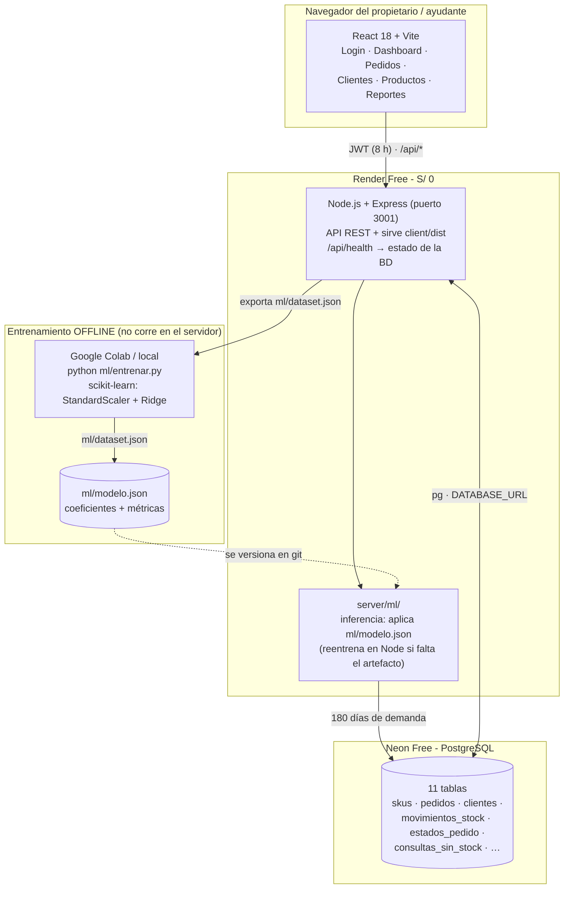
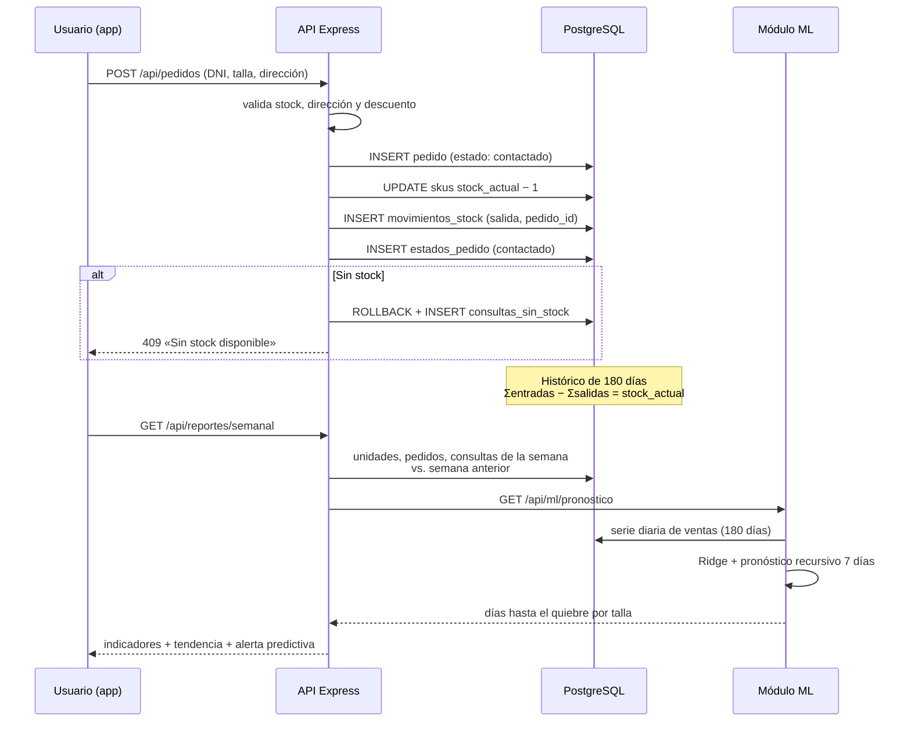
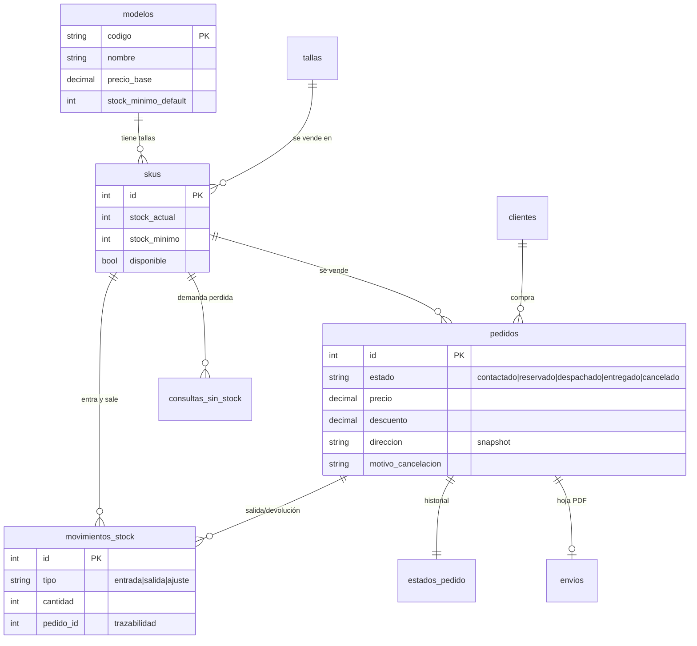
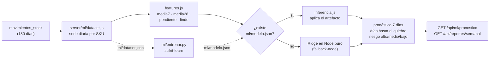

# Play One - Arquitectura del sistema

Diagrama de despliegue y de flujo de datos. Se usa en el informe (APA 7) y en la demo.

## 1. Despliegue (Render + Neon)



**Claves del diseño**

- **Entrenamiento offline → inferencia online.** El servidor nunca entrena: sólo aplica
  `ml/modelo.json` (~1 ms por request). Si el artefacto falta, reentrena en Node puro y lo
  marca `"origen": "fallback-node"`.
- **Neon en vez de Render Postgres:** el Postgres de Render Free expira a los 30 días;
  el de Neon no. La BD mide ~9 MB de 1 GB.
- **Render Free duerme a los 15 min:** el cold start tarda ~1 min. Para la demo, se abre
  el link antes (ver `DEMO.md`).

## 2. Flujo de un pedido (con la trazabilidad de stock)



## 3. Modelo de datos



**Invariante del histórico** (lo verifica `npm run db:setup` y aborta si falla):

```
Σ(entradas) − Σ(salidas) = stock_actual     en cada SKU disponible
```

## 4. Módulo ML



Ver [`../ml/README.md`](../ml/README.md) para las fórmulas, las características y las
métricas del backtest.
